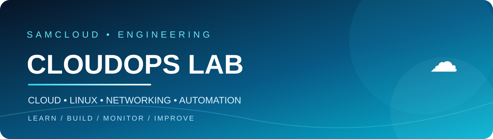

# ☁️ SAMCLOUD | CloudOps-Lab

### Building Practical Cloud & Infrastructure Engineering Skills

Linux • Networking • AWS • Automation • Troubleshooting

**A practical, continuously evolving engineering laboratory.**

---

## 👨‍💻 About This Repository

Welcome to **CloudOps-Lab**, a hands-on learning and documentation
repository focused on cloud computing, infrastructure, system
administration, networking and automation.

This repository documents my journey toward becoming a
Cloud / Infrastructure Engineer.

My focus is on understanding real-world infrastructure,
learning practical operations and developing troubleshooting skills.

## 🎯 Core Objectives

- Understand Linux system administration.
- Build strong networking fundamentals.
- Learn AWS cloud infrastructure.
- Explore monitoring and operational practices.
- Automate repetitive tasks using Bash and Python.
- Document practical projects and troubleshooting procedures.

## 🧰 Technology Stack

| Domain | Technologies |
|---|---|
| Cloud | AWS |
| Operating Systems | Linux |
| Networking | TCP/IP, DNS, HTTP, HTTPS |
| Compute | Amazon EC2 |
| Storage | Amazon S3 |
| Identity | AWS IAM |
| Networking Cloud | Amazon VPC |
| Monitoring | Amazon CloudWatch |
| Scripting | Bash, Python |
| Version Control | Git, GitHub |
| Environment | Termux, Linux |

## 📂 Repository Structure

| Directory | Description |
|---|---|
| `01-Linux` | Linux commands and administration |
| `02-Networking` | Networking fundamentals and protocols |
| `03-AWS` | AWS services and practical documentation |
| `04-Automation` | Bash and Python scripts |
| `05-Projects` | Practical engineering projects |
| `06-Troubleshooting` | Operational troubleshooting guides |
| `assets` | Diagrams and project images |
| `scripts` | Utility scripts |

## ☁️ AWS Learning Modules

| Service | Learning Focus |
|---|---|
| EC2 | Virtual servers and compute |
| S3 | Object storage |
| IAM | Identity and access management |
| VPC | Virtual networking |
| CloudWatch | Monitoring and observability |

## 🐧 Linux Learning Modules

- Essential Linux commands
- Directory and file management
- Users and groups
- File permissions
- Processes and services
- Disk and memory monitoring
- System troubleshooting

## 🌐 Networking Learning Modules

- OSI and TCP/IP models
- IPv4 and subnetting
- DNS and DHCP
- HTTP and HTTPS
- Ports and protocols
- Routing fundamentals
- Network troubleshooting

## ⚙️ Automation

This repository includes beginner-friendly automation examples:

- System health checks
- Disk usage reports
- Basic log analysis
- Python system information tools
- Repetitive task automation

## 🏗️ Practical Projects

Projects will be documented with:

1. Project overview
2. Problem statement
3. Architecture
4. Tools and technologies
5. Implementation
6. Screenshots
7. Testing
8. Results and lessons learned

## 🗺️ Learning Roadmap

- [x] Repository structure created
- [x] Documentation foundation
- [ ] Linux administration labs
- [ ] Networking practical labs
- [ ] AWS fundamentals
- [ ] EC2 deployment lab
- [ ] S3 storage lab
- [ ] IAM access management lab
- [ ] VPC networking lab
- [ ] CloudWatch monitoring lab
- [ ] Automation projects
- [ ] Infrastructure troubleshooting projects

## 📊 Engineering Philosophy

> Learn the fundamentals. Build practical systems.
> Document every experiment. Improve continuously.

## 🔗 Connect With Me

- LinkedIn: [Samarth Kharose](https://www.linkedin.com/in/samarth-kharose-708585449/)
- GitHub: [My GitHub Profile](https://github.com)
- YouTube: [@samstack7](https://youtube.com/@samstack7)

## 📜 License

This repository is licensed under the MIT License.
See [LICENSE](LICENSE) for details.

---

**SAMCLOUD | Cloud & Infrastructure Engineering**

*Learning Today. Building Tomorrow.*

